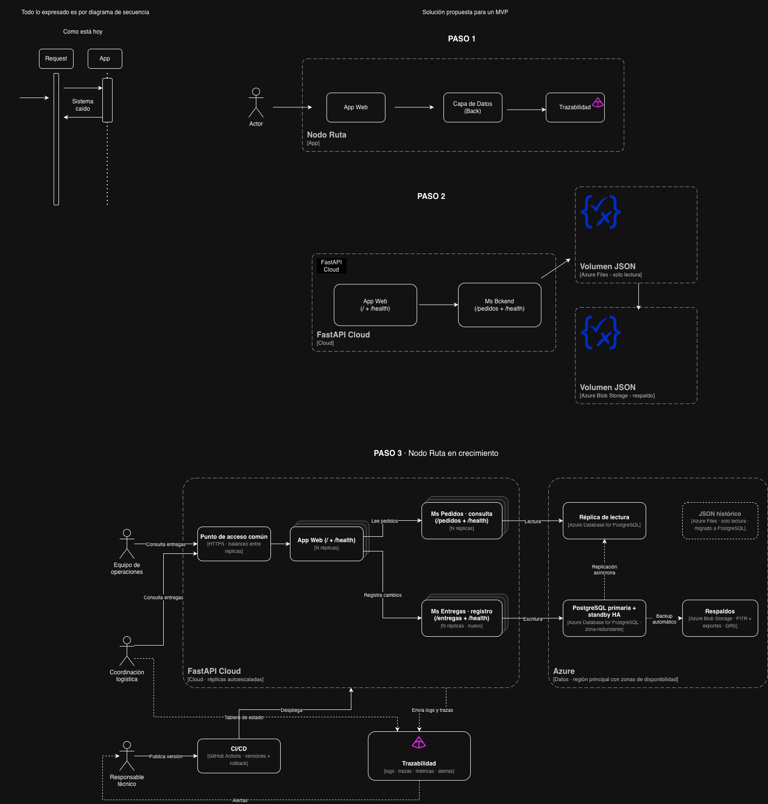
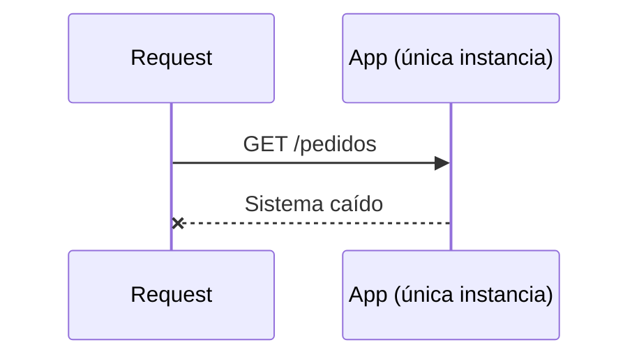
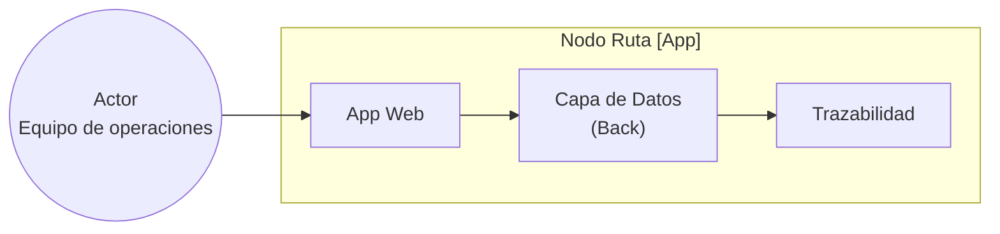
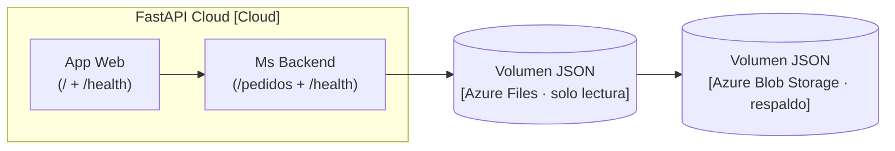
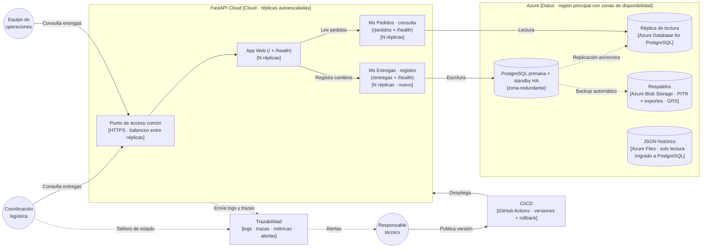

# Nodo Ruta · Servicio de consulta de entregas

> Hackatón EstudIA · Nube e infraestructura · Capa 2
> Caso ficticio con datos sintéticos.

Nodo Ruta es un servicio que permite consultar el estado de las entregas (`/pedidos`) y su salud (`/health`). Este repositorio contiene el servicio original y la propuesta de arquitectura del equipo para evolucionarlo en tres pasos: **visibilidad**, **separación costo-eficiente** y **escalamiento**.



La fuente editable de los diagramas está en [`docs/architecture/c4-sequence-diagrams.drawio`](docs/architecture/c4-sequence-diagrams.drawio) (se abre con [diagrams.net](https://app.diagrams.net)).

---

## Contenido

- [El problema](#el-problema)
- [Actores](#actores)
- [Situación actual](#situación-actual--diagrama-de-secuencia)
- [Ruta de evolución](#ruta-de-evolución)
  - [Paso 1 · Visibilidad del servicio](#paso-1--visibilidad-del-servicio)
  - [Paso 2 · Separación costo-eficiente (MVP)](#paso-2--separación-costo-eficiente-mvp)
  - [Paso 3 · Nodo Ruta en crecimiento](#paso-3--nodo-ruta-en-crecimiento)
- [Estructura del repositorio](#estructura-del-repositorio)
- [Ejecución local](#ejecución-local)
- [Respaldo y recuperación de datos](#respaldo-y-recuperación-de-datos)

---

## El problema

El servicio es un **monolito en una sola instancia**: la página web, la API (`/pedidos`, `/health`) y el archivo JSON de datos comparten el mismo ciclo de vida. La configuración y las actualizaciones se hacen a mano. Si la instancia se detiene o una versión introduce un error, las consultas dejan de responder y no existe un procedimiento probado para recuperar los datos.

**El dolor**

- **No se sabe cuándo falla:** la caída se detecta cuando alguien se queja.
- **Interrupción operativa:** el equipo busca la información por otros medios.
- **Recuperación improvisada:** se reinicia y se busca una copia, sin tiempos ni verificación de datos.
- **Actualizar da miedo:** no hay forma ordenada de volver a una versión funcional.

## Actores

| Actor | Rol frente al sistema |
| --- | --- |
| Equipo de operaciones | Usuario final: consulta el estado de las entregas. |
| Responsable técnico | Publica versiones, configura y atiende incidentes. |
| Coordinación logística | Necesita conocer el estado del servicio y sus limitaciones. |

## Situación actual · Diagrama de secuencia

Una solicitud llega a la única instancia de la aplicación. Si esa instancia está caída, la consulta no obtiene respuesta.



- **Punto único de falla:** presentación, API y datos viven en la misma instancia. Si se pierde la instancia, se pierden a la vez el servicio y, potencialmente, el archivo de datos.
- **Sin visibilidad:** no hay registros ni chequeos de salud consultables. El fallo lo descubre el usuario, no el sistema.

## Ruta de evolución

| Paso | Objetivo | Dolor que ataca |
| --- | --- | --- |
| 1 | Visibilidad: trazabilidad del servicio | No saber cuándo ni por qué falla |
| 2 | Separar instancias de forma costo-eficiente (FastAPI Cloud + Azure Files) | Punto único de falla y datos acoplados a la instancia |
| 3 | Escalar con más instancias cuando Nodo Ruta crezca | Volumen, escrituras y disponibilidad a mayor escala |

### Paso 1 · Visibilidad del servicio

*C4 · contenedores.* Antes de redistribuir la carga, el sistema tiene que poder decir en qué estado está.



- El **actor** (equipo de operaciones) consulta la **App Web**.
- La App Web obtiene los pedidos de la **Capa de Datos (Back)**.
- El Back envía sus eventos a **Trazabilidad** (ecosistema Pydantic): registros, chequeos de salud y trazas de cada solicitud.

| Resuelve | No resuelve todavía |
| --- | --- |
| Saber cuándo falla, qué instancia atendió cada solicitud y cuánto tarda la recuperación. | Sigue siendo una sola instancia: una caída continúa interrumpiendo el servicio. |

### Paso 2 · Separación costo-eficiente (MVP)

*C4 · contenedores.* Se separan las instancias sobre el mismo ecosistema Python (FastAPI Cloud) y se mantiene el volumen de datos en JSON, ahora en Azure Files, para no perjudicar la operación.



- **FastAPI Cloud** aloja dos componentes: **App Web** (`/` + `/health`) y **Ms Backend** (`/pedidos` + `/health`).
- El Ms Backend lee el **JSON en Azure Files en modo solo lectura**: los datos quedan fuera del almacenamiento efímero del contenedor.
- El volumen se respalda en **Azure Blob Storage**, separado de la copia de trabajo.
- No se cambia el formato de datos: el código se ajusta lo mínimo y la operación no se interrumpe.

**Relación con las pruebas del MVP**

| Prueba de la ficha | Cómo se cubre |
| --- | --- |
| Punto de acceso común e instancias | FastAPI Cloud como entrada; cada respuesta identifica la instancia. |
| Detener una instancia | Réplicas del Ms Backend; la trazabilidad del Paso 1 registra la interrupción. |
| Recrear un contenedor | El JSON vive en Azure Files, no en el contenedor. |
| Respaldar, alterar y restaurar | Respaldo en Blob Storage; se compara el identificador de versión. |
| Medir el tiempo de recuperación | Marcas de tiempo en la trazabilidad. |

**Por qué es costo-eficiente**

- Se queda en el mismo ecosistema Python/FastAPI: no hay que reescribir la aplicación ni aprender otro runtime.
- Se mantiene el JSON: no hay motor de base de datos que pagar ni migrar.
- Azure Files y Blob Storage cobran por almacenamiento y operaciones. Con seis pedidos ficticios el consumo es mínimo y cabe en cuentas educativas.

> [!IMPORTANT]
> **Por validar en la implementación**
> 1. El Ms Backend debe correr con **al menos dos réplicas** detrás del punto de acceso común (requisito del MVP).
> 2. Confirmar cómo FastAPI Cloud accede a Azure Files (montaje del volumen o lectura vía SDK/REST).
> 3. Las credenciales de Azure van como secretos de la plataforma, nunca dentro de la imagen ni en el repositorio.

### Paso 3 · Nodo Ruta en crecimiento

*Diagrama nuevo · propuesta.* Cuando la operación crece (más usuarios, más pedidos y la necesidad de registrar cambios, no solo consultarlos), el servicio pasa a varias instancias por componente y los datos a una base administrada con alta disponibilidad.



**Qué cambia frente al Paso 2**

| Aspecto | Paso 2 | Paso 3 |
| --- | --- | --- |
| Instancias | Pocas réplicas fijas | N réplicas autoescaladas por componente, detrás de un punto de acceso común |
| Dominio | Solo consulta (`/pedidos`) | Consulta + registro de entregas (servicio nuevo, separado por tipo de carga) |
| Datos | JSON en Azure Files | Azure Database for PostgreSQL: primaria con standby zona-redundante + réplica de lectura. El JSON queda como histórico migrado. |
| Respaldo | Copia en Blob Storage | Backups automáticos con restauración a un punto en el tiempo (PITR) + exportes en Blob con redundancia geográfica |
| Operación | Trazabilidad | Trazabilidad con alertas, tablero de estado para coordinación y CI/CD con rollback de versiones |

**Cuándo dar el paso (disparadores)**

- El servicio necesita **escribir** (registrar o actualizar entregas), no solo leer.
- El volumen de pedidos o de usuarios hace que el JSON compartido sea un cuello de botella.
- La organización define un objetivo de disponibilidad (SLO) que una sola zona no cubre.

**Factores de costo a vigilar**

- Número de réplicas activas y horas de cómputo en FastAPI Cloud.
- Tier de PostgreSQL: la alta disponibilidad zona-redundante y las réplicas de lectura requieren tiers de pago.
- Almacenamiento y retención de backups, y redundancia geográfica en Blob.
- Volumen de registros y trazas enviados a la herramienta de trazabilidad.
- Tráfico de salida entre FastAPI Cloud y Azure.

> [!NOTE]
> El Paso 3 es un diseño de referencia y no se implementa en la hackatón. Al tener cómputo (FastAPI Cloud) y datos (Azure) en proveedores distintos hay latencia y tráfico entre ellos. Si eso pesa, conviene evaluar llevar el cómputo a Azure (por ejemplo, Azure Container Apps) para tener red privada.

---

## Estructura del repositorio

```text
.
├── app.py                     # Servicio HTTP: /, /health y /pedidos
├── pedidos.json               # Datos ficticios (versión + lista de pedidos)
├── Dockerfile                 # Imagen del servicio (puerto 8080)
├── scripts/
│   ├── datos.py               # Preparar, respaldar, simular error y restaurar datos
│   ├── ejecutar_local.py      # Levantar una instancia local
│   └── verificar_servicio.py  # Consultas secuenciales y registro de evidencia
├── ayuda_opcional/
│   ├── compose.yaml           # Referencia: dos instancias + proxy NGINX
│   └── nginx.conf             # Balanceo con reintentos y detección pasiva de fallos
├── docs/architecture/         # Diagramas C4 y de secuencia (PNG + draw.io)
├── GUIA_ESTUDIANTE.md         # Guía del reto
├── PLANTILLA_EVIDENCIAS.md    # Plantilla para documentar pruebas
└── REFERENCIAS.md             # Documentación oficial consultada
```

## Ejecución local

Requiere Python 3.

```bash
# 1. Preparar la copia de trabajo de los datos (data/pedidos.json)
python scripts/datos.py preparar

# 2. Levantar una instancia
python scripts/ejecutar_local.py --puerto 8080 --id local-1

# 3. En otra terminal, verificar el servicio y guardar evidencia
python scripts/verificar_servicio.py http://127.0.0.1:8080/pedidos --peticiones 10
```

Con Docker Compose (dos instancias detrás de NGINX):

```bash
python scripts/datos.py preparar
docker compose -f ayuda_opcional/compose.yaml up --build
python scripts/verificar_servicio.py --esperadas app1,app2
```

| Ruta | Respuesta |
| --- | --- |
| `GET /` | Nombre del servicio, instancia y rutas disponibles |
| `GET /health` | `estado`, `instancia` y `version_datos`; `503` si los datos son inválidos |
| `GET /pedidos` | Instancia que responde, versión y lista de pedidos |

## Respaldo y recuperación de datos

```bash
python scripts/datos.py respaldar                                 # crea respaldos/<fecha>.json + .sha256
python scripts/datos.py simular-error                             # corrompe la copia de trabajo (/health → 503)
python scripts/datos.py restaurar --respaldo respaldos/<archivo>.json  # valida la huella y restaura
```

Después de restaurar, verifique `/health`, `/pedidos`, la versión de los datos y su contenido.
